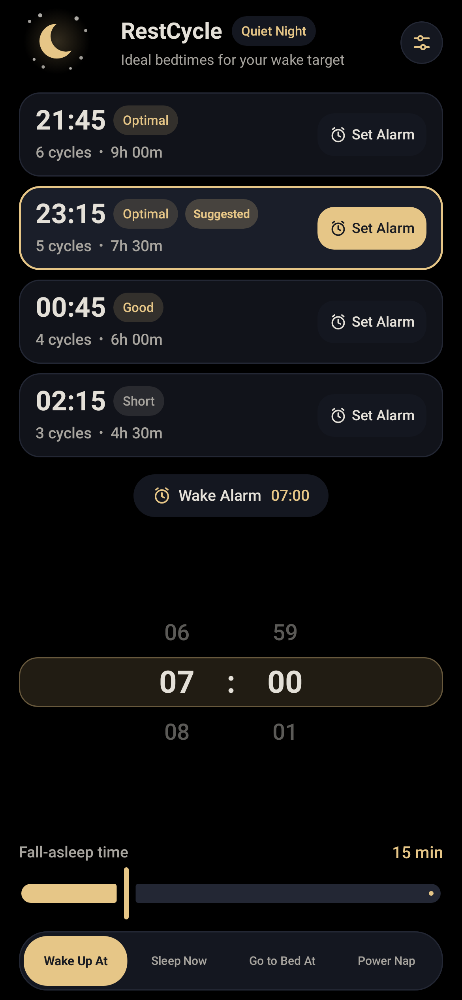
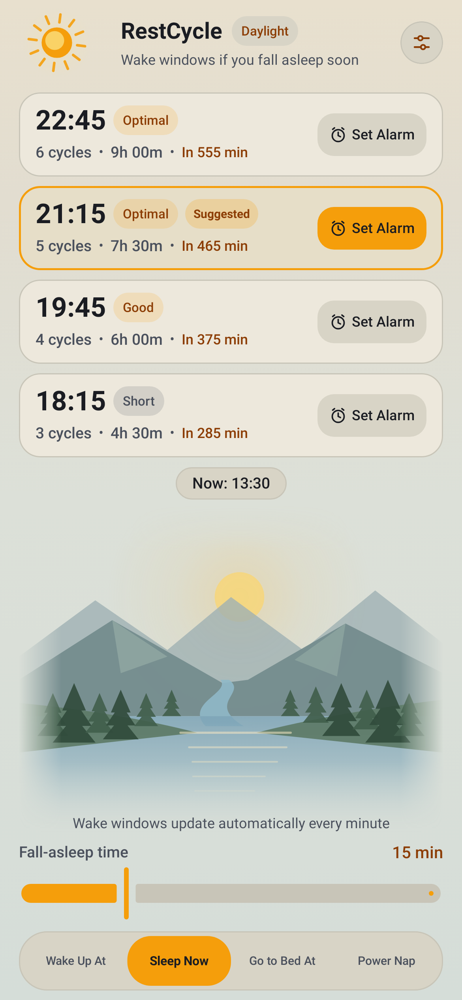
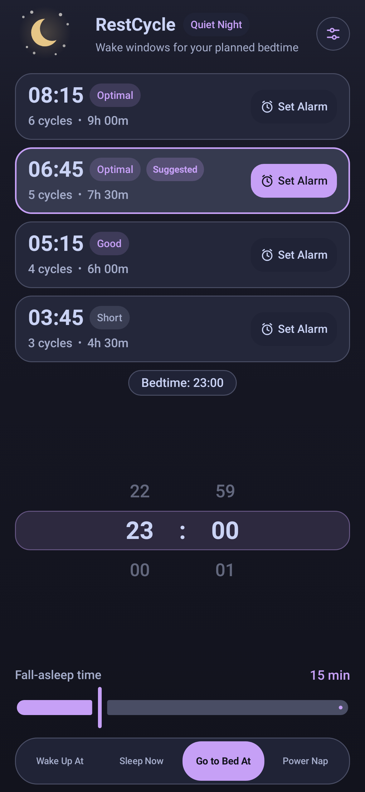

<div align="center">

# 🌙 RestCycle

**Native Android Sleep Cycle & Power Nap Calculator**  
*Zero Tracking • 120Hz AMOLED Optimized • Dynamic Celestial Atmosphere Engine*

[-3DDC84?style=for-the-badge&logo=android&logoColor=white)](https://developer.android.com/)
[](https://kotlinlang.org/)
[](https://developer.android.com/jetpack/compose)
[](#testing)
[](#privacy--permissions)

</div>

---

## ✨ Overview

**RestCycle** is a minimalist, zero-latency sleep cycle and power nap calculator built natively for Android with **Kotlin**, **Jetpack Compose**, and **Material 3**. Designed for effortless one-handed use in the thumb zone, RestCycle calculates optimal sleep and wake windows based on **90-minute REM sleep cycles** and your personal **sleep latency** — with zero ads, zero telemetry, and an optional GitHub Release update checker inside Settings.

Every interaction reacts in real time: as you scroll the haptic time wheel or switch modes, the entire sky, UI palette, and seamless alpine landscape smoothly transition across **Day**, **Dawn / Dusk**, and **Night** atmospheres.

---

## 📸 Screenshots

<div align="center">

| Wake Up At *(Dynamic Sky · Night)* | Sleep Now *(Dynamic Sky · Day)* | Power Nap *(Nord · Twilight)* | Go to Bed At *(Catppuccin Macchiato)* |
| :---: | :---: | :---: | :---: |
|  |  |  |  |

</div>

---

## 🚀 Key Features

### 🧭 4 Reactive Calculation Modes
| Mode | Purpose | How It Works |
| :--- | :--- | :--- |
| **Wake Up At** | Plan your bedtime | Pick when you want to wake up; RestCycle works backwards in 90-minute cycles minus your sleep latency. |
| **Sleep Now** | Instant wake targets | Uses your live device clock + sleep latency to calculate optimal wake-up times for 6 down to 1 cycles. |
| **Go to Bed At** | Plan future sleep | Choose a planned bedtime and see every optimal wake-up window ahead. |
| **Power Nap** | Science-backed naps | One-tap **10 min** (Micro), **20 min** (Optimal), and **90 min** (Full Cycle) presets with built-in sleep-inertia guidance. |

### 🌅 Dynamic Celestial Atmosphere Engine & Themes
RestCycle features **5 curated themes**, and **all 5 dynamically adapt across 3 time-of-day phases (`DAY`, `DAWN_DUSK`, `NIGHT`)** — synchronized across the sky backdrop, cards, controls, status bar, and landscape illustration with zero transition delay, plus an optional **Pure AMOLED Black (`#000000`)** night mode toggle:

- **Dynamic Sky** — Soft daylight sky, warm twilight sunset, and deep AMOLED midnight.
- **Nord** — Polar Snow Storm by day, Frost & Aurora Twilight at dawn/dusk, and Polar Night at night.
- **Catppuccin Macchiato** — Warm Latte-inspired daylight, Mauve/Peach twilight, and authentic Macchiato night.
- **Tokyo Night** — Crisp Tokyo Day, warm Neon Twilight, and deep Tokyo Night.
- **Gruvbox** — Warm retro parchment daylight, Ember Twilight, and Gruvbox Dark night.

### 🏔️ Borderless Alpine Landscape Scene
In **Sleep Now** and **Power Nap** modes, the open lower canvas renders a custom Jetpack Compose `Canvas` alpine landscape — layered mountains, pine silhouettes, a winding stream, and a gently shimmering lake — seamlessly feathered into the background (`BlendMode.DstIn`) with living time-of-day micro-animations (shooting star at night, valley mist at golden hour, drifting cloud wisps by day) and dynamically re-tinted to match your active theme.

### 🎛️ One-Handed Ergonomics & Polish
- **3D Cylindrical Haptic Time Wheel & Quick Time Chips** — GPU-accelerated 3D cylinder perspective with edge fade, tactile `CLOCK_TICK` feedback, tabular numerals (`tnum`), automatic `AM ↔ PM` toggling across `11 ↔ 12`, and one-tap preset chips (`06:00–07:30` / `22:00–00:00`).
- **Visual Cycle Capsules & Bedtime Countdown** — 6-capsule sleep cycle indicator on every card plus a live *"time until bedtime"* countdown in **Wake Up At** mode.
- **Fluid 120Hz Animations** — Smooth `220ms` wheel ↔ landscape mode transitions, sliding spring pill selector, smooth latency slider (`0–60 min`, default `15 min`), and unified frame-synchronized theme interpolation.
- **Remembered Schedule** — Persists your last selected wake-up time, bedtime, and scheduled mode locally via Jetpack DataStore.
- **Home Screen Widget** — Glanceable 4×1 home screen widget displaying live 5-cycle & 6-cycle wake windows right from your launcher.
- **4-7-8 Sleep Breathing Guide** — Built-in 120Hz breathing orb animation (`4s Inhale • 7s Hold • 8s Exhale`) with subtle haptic cues right from *Sleep Now* / *Power Nap*.
- **Caffeine Cutoff Indicator** — Shows your recommended last caffeine time (`☕`, configurable Off / 6h / 8h / 10h before bedtime).
- **Bedtime Wind-Down Reminder** — Optional local `AlarmManager` notification 20 minutes before your ideal bedtime (zero background battery drain).
- **Native Alarm & Timer Integration** — Tap any calculated cycle card to launch Android's native `AlarmClock` (`ACTION_SET_ALARM` / `ACTION_SET_TIMER`) directly with the exact target time and label.
- **Flexible Clock Format** — Choose **System Default**, **24-hour**, or **12-hour** in Settings (`⚙️`).
- **7-Language Localization & In-App Switcher** — Switch languages anytime inside Settings (`🌐 Auto`, `🇬🇧 English`, `🇭🇺 Magyar`, `🇪🇸 Español`, `🇷🇴 Română`, `🇵🇱 Polski`, `🇵🇹 Português`, `🇧🇷 Português (BR)`) with strict lint translation checks.
- **Optional GitHub Release Auto-Updater** — Opening Settings (`⚙️`) quietly checks GitHub Releases against your installed version and lets you download the newest APK with one tap if available — **never forced**.

---

## 🔒 Privacy & Permissions

RestCycle has **zero ads, zero analytics, and zero background tracking**:
- **Minimal Permissions:** Uses only `com.android.alarm.permission.SET_ALARM` (to set alarms/timers in your Clock app) and `android.permission.INTERNET` (used strictly when you open Settings or tap *Check for updates* to query `api.github.com/repos/kicsirigo/RestCycle/releases/latest` and download updates you choose).
- **Local Preferences:** Sleep latency, theme, 12h/24h format, and language are stored locally via **Jetpack DataStore**.

---

## 📦 Download & Verification

Pre-built APKs are available on the [**Releases**](https://github.com/kicsirigo/RestCycle/releases) page:

- **`RestCycle-release.apk`** (~1.3 MB) — Recommended. R8-minified, resource-shrunk, and signed with a private release key.
- **`RestCycle-debug.apk`** (~13 MB) — Unminified debug build for testing and inspection.

### Verify APK Integrity
Download `SHA256SUMS.txt` from the release and verify locally:
```bash
sha256sum -c SHA256SUMS.txt
```

### Verify Signing Certificate (Release APK)
```bash
apksigner verify --print-certs RestCycle-release.apk
```
Expected signing certificate:
- **Subject DN:** `CN=kicsirigo, OU=Mobile, O=RestCycle, L=Budapest, C=HU`
- **SHA-256:** `479743c1db8934a55692cdc66bd77e3b6b8312c0b68351ccd13be5ead85075b1`
- **SHA-1:** `5bfc1e8b14cac421884a244f0895dea531d74dfd`

> **Note on Google Play Protect:** Because RestCycle is distributed directly outside the Google Play Store and signed with an independent developer key, Android / Play Protect may show an *"Unrecognized app / developer"* prompt on first install. You can verify the SHA-256 checksum and signing certificate above or build the APK directly from this source code.

---

## 🛠️ Tech Stack & Architecture

- **Language:** Kotlin 2.1 (JVM 21 toolchain)
- **UI:** Jetpack Compose + Material 3 (Edge-to-Edge, `Canvas` rendering, `CompositionLocal` atmosphere provider)
- **State & Persistence:** `ViewModel`, `StateFlow`, `androidx.datastore:datastore-preferences`
- **Min / Target SDK:** API 26 (Android 8.0) / API 36 (Android 16)
- **Testing:** JUnit 4, Kotlin Coroutines Test, Robolectric, Compose UI Test, Espresso Intents

```text
app/src/main/java/com/restcycle/app/
├── MainActivity.kt                          # Edge-to-edge host, live clock ticker, AlarmClock intents
├── RestCycleApplication.kt                  # Application entry point
├── data/preferences/
│   └── LatencyPreferencesRepository.kt      # DataStore persistence (latency, theme, time format, language)
├── domain/
│   ├── calculator/
│   │   ├── SkyPhaseResolver.kt              # Time-of-day atmosphere phase resolver
│   │   └── SleepCycleCalculator.kt          # 90-min cycle math, Power Nap presets, midnight rollover
│   └── model/
│       └── SleepContracts.kt                # Modes, TimeFormatPreference, AtmospherePhase, domain models
├── platform/
│   ├── intent/AlarmScheduler.kt             # Native AlarmClock alarm & timer handoff
│   ├── time/TimeFormatProvider.kt           # System / 12h / 24h clock format provider
│   └── update/GitHubUpdateChecker.kt        # Optional GitHub Releases version check & APK download
└── ui/
    ├── screen/RestCycleScreen.kt            # Adaptive thumb-zone layout & mode orchestration
    ├── viewmodel/SleepViewModel.kt          # Reactive unidirectional state flow
    ├── components/
    │   ├── CelestialHeader.kt               # Header with live status & Settings button
    │   ├── CelestialLandscapeScene.kt       # Borderless mountain/forest/stream/lake Canvas scene
    │   ├── HapticTimeWheel.kt               # 12h/24h snapping wheel with CLOCK_TICK & AM/PM auto-flip
    │   ├── LatencySlider.kt                 # Animated 0–60 min sleep latency slider
    │   ├── ModeSegmentedBar.kt              # Spring-animated 4-mode navigation pill
    │   ├── PowerNapSection.kt               # 10 / 20 / 90 min power nap selector + inertia tip
    │   ├── SleepOptionCard.kt               # Cycle cards with quality badges & alarm handoff
    │   └── SettingsDialog.kt                # Theme, 12h/24h, language selectors & credits
    └── theme/
        ├── AtmosphereTheme.kt               # Unified 3-phase color interpolation (Dynamic Sky / Nord / Catppuccin)
        └── Type.kt                          # Typography with tabular numerals (tnum)
```

---

## 🏗️ Building from Source

### Prerequisites
- **JDK 21**
- **Android SDK** with Build-Tools & Platform API 36

### Build Commands
```bash
# Clone the repository
git clone https://github.com/kicsirigo/RestCycle.git
cd RestCycle

# Run all 334 unit & Compose/Robolectric E2E tests
./gradlew testDebugUnitTest

# Run Android Lint checks
./gradlew lintDebug

# Build Debug APK
./gradlew assembleDebug

# Build Release APK (uses debug signing automatically if no release keystore is configured)
./gradlew assembleRelease
```

To sign a release build with your own keystore, supply the following environment variables or Gradle properties:
```bash
export RESTCYCLE_STORE_FILE="path/to/your-keystore.jks"
export RESTCYCLE_STORE_PASSWORD="your-store-password"
export RESTCYCLE_KEY_ALIAS="your-key-alias"
export RESTCYCLE_KEY_PASSWORD="your-key-password"
./gradlew assembleRelease
```

---

## 🧪 Testing

The test suite includes **334 automated tests** covering:
- Sleep cycle math, midnight/DST boundaries, and Power Nap calculations
- Dynamic Celestial Atmosphere Engine phase detection & color interpolation across all 3 themes
- DataStore preference persistence and defaults
- End-to-end Compose UI & Robolectric verification (12h/24h wheel rollover, mode switching, settings dialog, alarm intent dispatch)

---

## 👤 Credits

**made by: kicsirigo**
