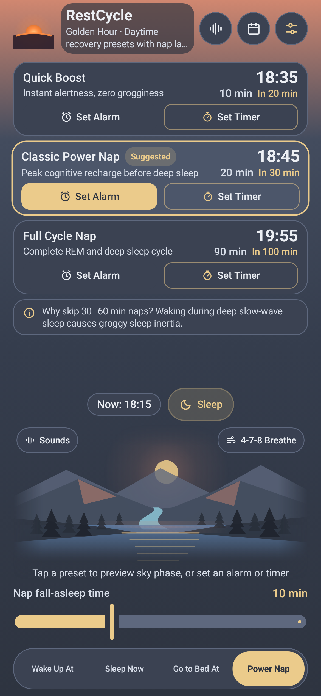
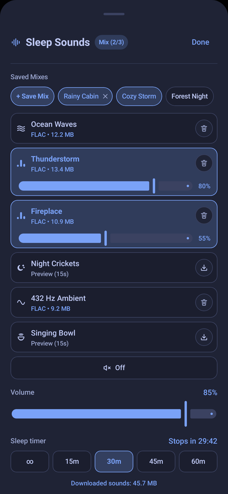
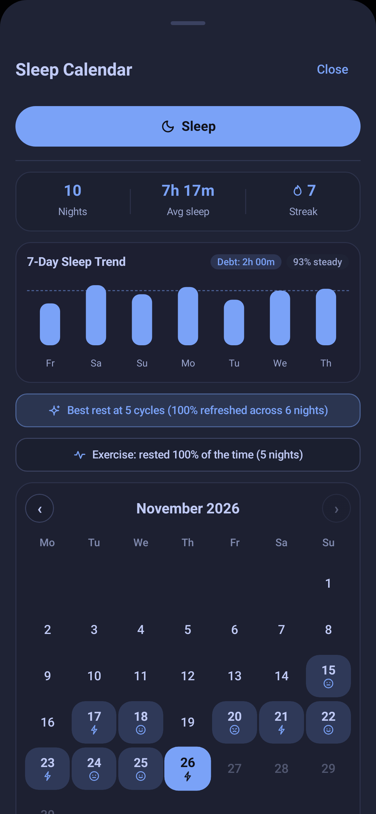
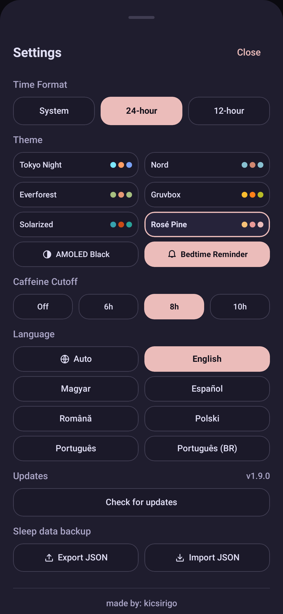

<div align="center">

# RestCycle

**Native Android Sleep Cycle, Multi-Track Ambient Sound Mixer & Sleep Journal App**  
*Zero Tracking • 120Hz AMOLED Optimized • Dynamic Celestial Atmosphere Engine*

[](https://github.com/kicsirigo/RestCycle/releases/latest)
[-3DDC84?style=for-the-badge&logo=android&logoColor=white)](https://developer.android.com/)
[](https://kotlinlang.org/)
[](https://developer.android.com/jetpack/compose)
[](#testing)
[](#privacy--permissions)

</div>

---

## Overview

**RestCycle** is a minimalist, zero-latency sleep cycle calculator, multi-track lossless ambient sound mixer, and all-time sleep journal built natively for Android with **Kotlin**, **Jetpack Compose**, and **Material 3**. Designed for effortless one-handed use in the thumb zone, RestCycle calculates optimal sleep and wake windows based on **90-minute REM sleep cycles** and your personal **sleep latency** — with zero ads, zero telemetry, unified monochrome vector iconography, expressive micro-interactions, and an optional in-app GitHub Releases updater.

Every interaction reacts in real time: as you scroll the haptic time wheel or switch modes, the entire sky, UI palette, and seamless alpine landscape smoothly transition across glare-free sunlit **Day**, **Dawn / Dusk**, and **Night** atmospheres.

---

## Screenshots

<div align="center">

| Wake Up At *(Tokyo Night)* | Sleep Now *(Solarized · Daylight)* | Power Nap *(Nord · Twilight)* |
| :---: | :---: | :---: |
|  |  |  |

| Multi-Track Sound Mixer | Sleep Calendar & 7-Day Trends | 6 Themes & Settings *(Rosé Pine)* |
| :---: | :---: | :---: |
|  |  |  |

</div>

---

## Key Features

### 4 Reactive Calculation Modes
| Mode | Purpose | How It Works |
| :--- | :--- | :--- |
| **Wake Up At** | Plan your bedtime | Pick when you want to wake up; RestCycle works backwards in 90-minute cycles (6 down to 3 cycles) minus your sleep latency. |
| **Sleep Now** | Instant wake targets | Uses your live device clock + sleep latency to calculate optimal wake-up times for 6 down to 3 cycles (`9h 00m` – `4h 30m`). |
| **Go to Bed At** | Plan future sleep | Choose a planned bedtime and see every optimal wake-up window ahead. |
| **Power Nap** | Science-backed naps | One-tap **10 min** (Quick Boost), **20 min** (Classic Power Nap), and **90 min** (Full Cycle) presets with built-in sleep-inertia guidance. |

### Multi-Track Ambient Sound Mixer, Lossless FLAC Packs & Screen-Off Playback
- **Multi-Track Mixer (Up to 3 Simultaneous Layers) & Saved Mixes** — Blend up to 3 soundscapes at once (e.g., *Thunderstorm* + *Fireplace*) with expandable inline per-track volume sliders, animated live equalizer bars, curated 1-tap presets (*Cozy Storm*, *Forest Night*, *Zen Rain*), and custom user-saved mixes persisted in DataStore.
- **On-Demand Lossless 48 kHz 16-Bit Stereo FLAC Packs + Offline Previews** — Keeps the release APK ultra-compact (**~2.7 MB**) by bundling 15-second offline previews for all 6 soundscapes (**Ocean Waves**, **Thunderstorm**, **Fireplace**, **Night Crickets**, **432 Hz Ambient**, **Singing Bowl**) while letting you download full studio-quality lossless `.flac` packs on demand directly inside the Sound sheet.
- **Perceptual Volume Curve, Sleep Timer & Pop-Free Screen-Off Audio** — Smooth quadratic perceptual volume slider (`0%–100%`), **Sleep Timer** (`∞`, `15m`, `30m`, `45m`, `60m`) with a gradual **30-second fade-out**, and a persistent `mediaPlayback` foreground service (`AmbientSoundService`) with `PARTIAL_WAKE_LOCK` so audio plays seamlessly with the screen locked.

### All-Time Sleep Calendar, 7-Day Trends & Factor Insights
- **7-Day Sleep Trend Chart, Sleep Debt & Bedtime Consistency** — Interactive 7-day bar chart plotted against your 7.5h sleep target, cumulative weekly **Sleep Debt**, and circular **Bedtime Consistency %** that accurately tracks schedule steadiness even across midnight rollovers.
- **Sleep Factor Tags & Correlation Insights** — Tag nights on wake-up or manual log with 6 custom monochrome-icon factors (**Late Caffeine**, **Exercise**, **Stress**, **Late Meal**, **Screen Time**, **Alcohol**). RestCycle automatically correlates tags with your morning mood alongside your personal optimal cycle-count insight.
- **Decluttered Monthly Calendar & Per-Minute Manual Log (`+ Log`)** — Unified 3-column KPI strip (**Nights**, **Avg sleep**, **Streak**), borderless empty day cells, directional horizontal month transitions, quick-tap protection, embedded **HapticTimeWheel** with `±1 min` steppers, and 4 wake-up mood ratings (**Exhausted**, **Fair**, **Rested**, **Energized**).
- **Offline JSON Backup (Export / Import)** — Export your entire All-Time Sleep Calendar (including factor tags) to a portable `.json` file and import/merge backups via Android's Storage Access Framework without duplicating existing nights.

### Dynamic Celestial Atmosphere Engine & 6 Curated Themes
All **6 classic developer-grade themes** dynamically adapt across **3 time-of-day phases (`DAY`, `DAWN_DUSK`, `NIGHT`)** — featuring glare-free sunlit mid-tone `DAY` skies, synchronized across the backdrop, cards, monochrome vector icons, system bars, and alpine landscape, plus an optional **Pure AMOLED Black (`#000000`)** night mode toggle:

- **Tokyo Night** *(Default)* — Sunlit Tokyo Sky by day, Neon Twilight at dawn/dusk, and deep Tokyo Night.
- **Nord** — Glare-free Polar Blue by day, Frost & Aurora Twilight at dawn/dusk, and Polar Night at night.
- **Everforest** — Sunlit Forest Sage by day, mossy twilight, and deep forest night.
- **Gruvbox** — Warm Amber Ochre by day, Ember Twilight, and Gruvbox Dark night.
- **Solarized** — Sunlit Solarized Teal by day, warm dusk horizon, and classic Solarized Dark night.
- **Rosé Pine** — Soft Rose Dusk by day, dusky rose twilight, and Rosé Pine Moon night.

### One-Handed Ergonomics, Expressive Motion & Utilities
- **Material 3 Expressive Micro-Interactions** — Rolling odometer digit animations (`RollingOdometerText`), spring press-scale feedback, staggered card entrances, expressive overshoot mode switcher, enlarged animated Moon sleep session pill, and unified `ModalBottomSheet` drawers for Sounds, Calendar, and Settings.
- **Unified Monochrome Vector Iconography** — Zero Unicode emojis anywhere in the UI; every button, pill, setting, mood, factor tag, and sound uses crisp 24dp monochrome vector paths dynamically tinted to the active theme, paired with a minimalist crescent moon adaptive launcher icon.
- **3D Cylindrical Haptic Time Wheel & Quick Time Chips** — GPU-accelerated 3D cylinder perspective with edge fade, tactile `CLOCK_TICK` feedback, tabular numerals (`tnum`), automatic `AM ↔ PM` toggling across `11 ↔ 12`, and one-tap preset chips (`06:00–07:30` / `22:00–00:00`).
- **Borderless Alpine Landscape Scene & 4-7-8 Breathing Guide** — Custom Jetpack Compose `Canvas` alpine landscape in *Sleep Now* and *Power Nap* modes plus a 120Hz 4-7-8 breathing orb (`4s Inhale • 7s Hold • 8s Exhale`) with subtle haptic pacing.
- **Caffeine Cutoff, Bedtime Reminder, Widget & Shortcuts** — Recommended last caffeine time (Off / 6h / 8h / 10h), optional local `AlarmManager` wind-down notification 20 minutes before bedtime, glanceable 4×1 home screen widget, and long-press launcher shortcuts (*Sleep Now*, *Power Nap*, *Breathe*).
- **Native Alarm & Timer Integration** — Tap any cycle card to launch Android's native `AlarmClock` (`ACTION_SET_ALARM` / `ACTION_SET_TIMER`) with the exact target time and label.
- **7-Language Localization & In-App Switcher** — Switch languages anytime inside Settings (**Auto**, **English**, **Magyar**, **Español**, **Română**, **Polski**, **Português**, **Português (BR)**) with strict lint translation parity checks.
- **In-App Update Download Manager & Direct Installer** — Opening Settings quietly checks GitHub Releases against your installed version; when an update is available, you can download the signed APK directly in-app with a live progress bar, MB readout, Cancel button, and one-tap system installer handoff via `FileProvider` (**never forced**).

---

## Privacy & Permissions

RestCycle has **zero ads, zero analytics, and zero background tracking**:
- `com.android.alarm.permission.SET_ALARM` — Sets alarms and timers in your system Clock app when you tap a sleep option.
- `android.permission.INTERNET` — Used strictly for optional GitHub Releases update checks/downloads and on-demand lossless FLAC sound pack downloads from `github.com/kicsirigo/RestCycle`.
- `android.permission.POST_NOTIFICATIONS` — Used for optional bedtime wind-down reminders and the ambient sound playback notification.
- `android.permission.FOREGROUND_SERVICE` & `android.permission.FOREGROUND_SERVICE_MEDIA_PLAYBACK` — Keeps ambient sleep audio playing reliably when the screen turns off.
- `android.permission.WAKE_LOCK` — Prevents audio dropouts/pops while the device CPU enters sleep mode during ambient playback.
- `android.permission.REQUEST_INSTALL_PACKAGES` — Enables launching Android's system package installer directly after downloading an update APK inside Settings.
- **Local Storage Only:** All preferences, saved sound mixes, and your All-Time Sleep Calendar history are stored locally on-device via **Jetpack DataStore** (plus portable offline `.json` backups whenever you choose to export).

---

## Download & Verification

Pre-built APKs are available on the [**Releases**](https://github.com/kicsirigo/RestCycle/releases) page:

- **`RestCycle-release.apk`** (~2.7 MB, with 6 offline sound previews + on-demand lossless FLAC packs) — Recommended. R8-minified, resource-shrunk, and signed with the project release key.
- **`RestCycle-debug.apk`** (~14 MB) — Unminified debug build for testing and inspection.

### Verify APK Integrity
Download `SHA256SUMS.txt` from the release and verify locally:
```bash
sha256sum -c SHA256SUMS.txt
```

### Verify Signing Certificate (Release APK)
```bash
apksigner verify --print-certs RestCycle-release.apk
```
Expected signing certificate:
- **Subject DN:** `CN=kicsirigo, OU=Mobile, O=RestCycle, L=Budapest, C=HU`
- **SHA-256:** `479743c1db8934a55692cdc66bd77e3b6b8312c0b68351ccd13be5ead85075b1`
- **SHA-1:** `5bfc1e8b14cac421884a244f0895dea531d74dfd`

> **Note on Google Play Protect:** Because RestCycle is distributed directly outside the Google Play Store, signed with an independent developer key, and includes an optional in-app GitHub Release updater (`REQUEST_INSTALL_PACKAGES`), Google Play Protect may display a warning on installation. You can verify the SHA-256 checksum and signing certificate above or build the APK directly from this source code, then choose **More details → Install anyway**.

---

## Tech Stack & Architecture

- **Language:** Kotlin 2.1 (JVM 21 toolchain)
- **UI:** Jetpack Compose + Material 3 (Edge-to-Edge, `Canvas` rendering, `ModalBottomSheet`, `CompositionLocal` atmosphere provider)
- **State & Persistence:** `ViewModel`, `StateFlow`, `androidx.datastore:datastore-preferences`
- **Min / Target SDK:** API 26 (Android 8.0) / API 36 (Android 16)
- **Testing:** JUnit 4, Kotlin Coroutines Test, Robolectric, Compose UI Test, Espresso Intents

```text
app/src/main/java/com/restcycle/app/
├── MainActivity.kt                          # Edge-to-edge host, SAF backup launchers, shortcut intents
├── RestCycleApplication.kt                  # Application entry point & DI container
├── data/preferences/
│   └── LatencyPreferencesRepository.kt      # DataStore persistence (latency, theme, mixes, history, settings)
├── domain/
│   ├── calculator/
│   │   ├── SkyPhaseResolver.kt              # Time-of-day atmosphere phase resolver
│   │   └── SleepCycleCalculator.kt          # 90-min cycle math (6–3 cycles), Power Nap presets, rollover
│   └── model/
│       ├── SleepContracts.kt                # Modes, AtmospherePhase, domain models
│       └── SleepHistoryRecord.kt            # History codec, 7-day trends, sleep debt, circular consistency, factor insights & JSON backup
├── platform/
│   ├── audio/
│   │   ├── AmbientSoundGenerator.kt         # Multi-track (up to 3 layers) FLAC/preview mixer & perceptual volume curve
│   │   ├── AmbientSoundPackManager.kt       # On-demand lossless FLAC pack downloader & storage manager
│   │   ├── AmbientSoundService.kt           # mediaPlayback ForegroundService, WAKE_LOCK & sleep timer fade-out
│   │   └── SoundMixPreset.kt                # Curated & custom saved sound mix codec
│   ├── intent/AlarmScheduler.kt             # Native AlarmClock alarm & timer handoff
│   ├── reminder/                            # Local AlarmManager bedtime wind-down notifications
│   ├── time/TimeFormatProvider.kt           # System / 12h / 24h clock format provider
│   ├── update/GitHubUpdateChecker.kt        # GitHub Releases check, streaming downloader & FileProvider installer
│   └── widget/RestCycleWidgetProvider.kt    # 4×1 home screen AppWidget
└── ui/
    ├── screen/RestCycleScreen.kt            # Adaptive thumb-zone layout & mode orchestration
    ├── viewmodel/SleepViewModel.kt          # Reactive unidirectional state flow
    ├── components/
    │   ├── AmbientSoundDialog.kt            # Multi-track mixer sheet, per-track sliders, saved mixes & FLAC downloads
    │   ├── BreathingExerciseDialog.kt       # 4-7-8 breathing orb with haptic pacing
    │   ├── CelestialHeader.kt               # Header with live status & 3 uniform circular action buttons
    │   ├── CelestialLandscapeScene.kt       # Borderless alpine Canvas scene
    │   ├── HapticTimeWheel.kt               # 12h/24h snapping wheel with CLOCK_TICK & AM/PM auto-flip
    │   ├── LatencySlider.kt                 # Animated 0–60 min sleep latency slider
    │   ├── ModeSegmentedBar.kt              # Expressive spring-animated 4-mode navigation pill
    │   ├── MotionComponents.kt              # RollingOdometerText, LiveEqualizerIcon & press-scale micro-interactions
    │   ├── PowerNapSection.kt               # 10 / 20 / 90 min power nap selector + inertia tip
    │   ├── RestCycleIcons.kt                # Unified 24dp monochrome vector icon library (including 6 factor icons)
    │   ├── SettingsDialog.kt                # Bottom sheet: 6 themes, AMOLED, languages, JSON backup & in-app updater
    │   ├── SleepOptionCard.kt               # Staggered cycle cards with rolling times, quality badges & alarm handoff
    │   └── SleepTrackerDialog.kt            # Calendar sheet, 7-day trend chart, sleep debt, consistency & factor tags
    └── theme/
        ├── AtmosphereTheme.kt               # Unified 3-phase color interpolation across 6 themes + AMOLED
        └── Type.kt                          # Typography with tabular numerals (tnum)
```

---

## Building from Source

### Prerequisites
- **JDK 21**
- **Android SDK** with Build-Tools & Platform API 36

### Build Commands
```bash
# Clone the repository
git clone https://github.com/kicsirigo/RestCycle.git
cd RestCycle

# Run all 348 unit & Compose/Robolectric E2E tests
./gradlew testDebugUnitTest

# Run Android Lint checks
./gradlew lintDebug

# Build Debug APK
./gradlew assembleDebug

# Build Release APK (uses debug signing automatically if no release keystore is configured)
./gradlew assembleRelease
```

To sign a release build with your own keystore, supply the following environment variables or Gradle properties:
```bash
export RESTCYCLE_STORE_FILE="path/to/your-keystore.jks"
export RESTCYCLE_STORE_PASSWORD="your-store-password"
export RESTCYCLE_KEY_ALIAS="your-key-alias"
export RESTCYCLE_KEY_PASSWORD="your-key-password"
./gradlew assembleRelease
```

---

## Testing

The test suite includes **348 automated tests** across 26 test suites covering:
- Sleep cycle math (6–3 cycles), midnight/DST boundaries, quick-tap protection, and Power Nap calculations
- Dynamic Celestial Atmosphere Engine phase detection & color interpolation across all 6 themes (`Tokyo Night`, `Nord`, `Everforest`, `Gruvbox`, `Solarized`, `Rosé Pine`) + Pure AMOLED Black
- Multi-track ambient sound mixer (3-layer cap, per-track volume scaling, saved mix preset serialization) and on-demand lossless FLAC pack manager
- All-Time Sleep Calendar, 7-day sleep trend chart, sleep debt, circular bedtime consistency %, sleep factor tags & correlation insights, per-minute manual logging, and offline JSON export/import/merge
- In-app GitHub Release update checker, redirect-following streaming downloader, and `FileProvider` install intent generation
- 7-language localization parity and monochrome vector icon integrity
- End-to-end Compose UI & Robolectric Tier 1–4 verification (12h/24h wheel rollover, mode switching, settings sheet, alarm intent dispatch)

---

## Credits

**made by: kicsirigo**
